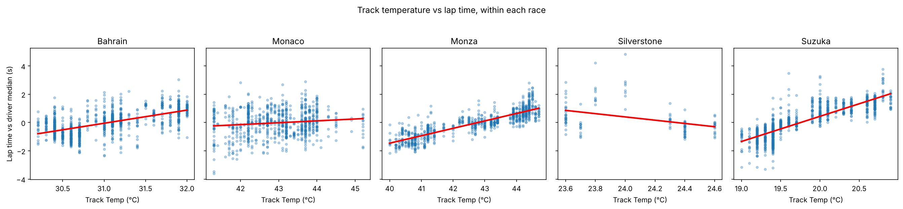
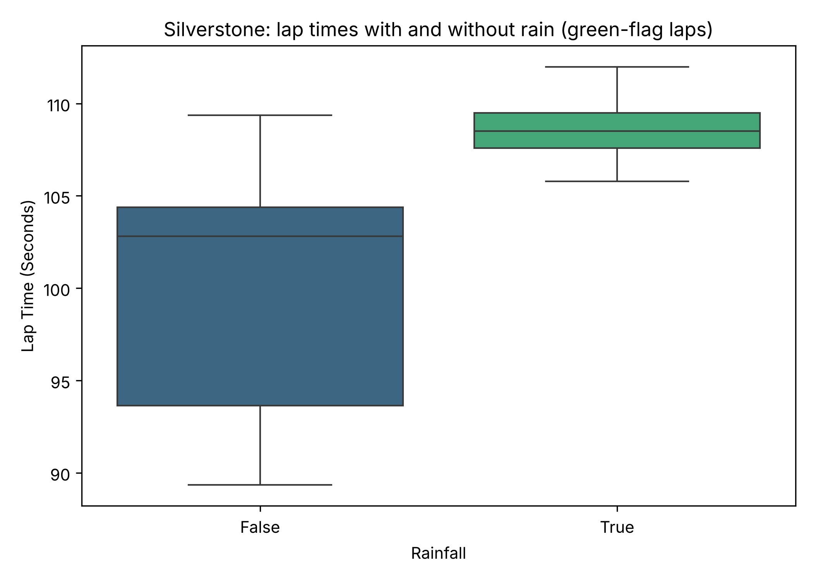
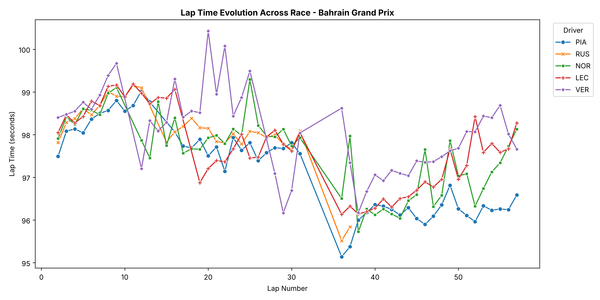

#  F1 Race Analysis: Tyres, Weather & Strategy

A collaborative data science project analysing official Formula 1 timing data from five races of the **2025 season**. It asks one main question:

> **What actually decides an F1 race: tyre wear, weather, strategy or raw pace?**

Built with Python, Jupyter, Git and GitHub as part of the *Collaborative Data Science Mini Project*.

---

##  Research Questions

1. How much do **track temperature** and **rain** affect lap times?
2. How quickly do **Soft, Medium and Hard** tyres lose performance, once fuel burn is accounted for?
3. Does pitting first (**undercut**) or staying out longer (**overcut**) win more position battles?
4. Can a model predict a driver's **lap-by-lap race position** on a race it has never seen?

---

##  Dataset

| Item | Details |
| :--- | :--- |
| **Source** | Official F1 timing data via the [FastF1](https://github.com/theOehrly/Fast-F1) Python library ([docs](https://docs.fastf1.dev)) |
| **Races** | 2025 Bahrain, Monaco, Silverstone, Monza and Suzuka Grands Prix |
| **File** | `data/processed/cleaned_laps.csv` |
| **Size** | 5,305 laps × 43 columns (~2.1 MB) |
| **Contents** | Lap times, tyre compound and age, stints, pit stops, positions, speed traps, and weather merged onto every lap |

Key column descriptions: [PROJECT_DOCUMENTATION.md](PROJECT_DOCUMENTATION.md)

---

## Team & Roles

| Member | GitHub | Branch | Responsibility | Main Files |
| :--- | :--- | :--- | :--- | :--- |
| **Member 1** | [@Utkarshsawant08](https://github.com/Utkarshsawant08) | `feature/data-pipeline-weather` | Data pipeline & weather analysis | `src/data_pipeline.py`, `notebooks/01_data_weather.ipynb` |
| **Member 2** | [@gavinvasco-prog](https://github.com/gavinvasco-prog) | `feature/tyre-degradation-modeling` | Tyre degradation, lap time model, undercut analysis, Git co-lead | `src/tyre_model.py`, `notebooks/Gavin_tyre_degradation.ipynb` |
| **Member 3** | [@riya-147](https://github.com/riya-147) | `feature/visualizations-readme` | Visualizations & documentation | `notebooks/03_visualizations.ipynb`, `PROJECT_DOCUMENTATION.md` |
| **Member 4** | [@AryaSankhalkar](https://github.com/AryaSankhalkar) | `feature/ml-race-prediction` | Race position model, Git co-lead | `src/race_model.py`, `notebooks/04_race_prediction.ipynb` |

---

##  Repository Structure

```text
f1-race-analysis/
├── .github/
│   └── pull_request_template.md     # Template used for every pull request
├── data/
│   ├── raw/                         # Raw data (kept local, ignored by Git)
│   └── processed/
│       └── cleaned_laps.csv         # Combined laps + weather dataset
├── notebooks/
│   ├── 01_data_weather.ipynb        # Weather analysis
│   ├── Gavin_tyre_degradation.ipynb # Tyre degradation, lap time model, undercut analysis
│   ├── 03_visualizations.ipynb      # Speed trap, lap evolution, tyre age charts
│   └── 04_race_prediction.ipynb     # Race position prediction model
├── reports/
│   └── figures/                     # Charts exported by the notebooks
├── src/
│   ├── data_pipeline.py             # Downloads and cleans race data with FastF1
│   ├── tyre_model.py                # Lap cleaning, lap delta, degradation regression, pit battles
│   └── race_model.py                # Feature preparation and race-based cross-validation
├── .gitignore
├── PROJECT_DOCUMENTATION.md         # Technical documentation
├── README.md
└── requirements.txt
```

---

## Key Findings

### 1. Weather (Member 1)



- **Rain** was only recorded at Silverstone. Green-flag laps in the rain were about **5.7 s slower** (median 108.5 s vs 102.8 s dry).
- **Track temperature** changes only 1–5 °C within a race. Hotter laps look slower, but track temperature also falls as the race goes on while fuel burns off, so the two effects cannot be separated.



### 2. Tyre Strategy (Member 2)

**Tyre degradation** (linear regression on lap time vs tyre age and lap number, 3,713 clean laps):

| Compound | Tyre wear (s per lap of age) | Fuel effect (s per lap) | R² | Laps |
| :--- | :---: | :---: | :---: | :---: |
| Soft | **+0.078** | −0.052 | 0.52 | 372 |
| Medium | +0.014 | −0.032 | 0.30 | 1,615 |
| Hard | +0.016 | −0.028 | 0.19 | 1,719 |

- **Softs wear about 5× faster** than Mediums and Hards.
- Cars get **0.03–0.05 s faster each lap** as fuel burns off, which hides tyre wear in raw lap time plots.

**Lap time prediction** (tyre age, compound, lap number, track temperature): average error **0.6 s**, test R² **0.338**. Track temperature had almost no effect (about 0.002 s per °C).

**Undercut vs overcut** (26 close pit battles with green-flag stops):

| Strategy | Battles | Successful | Success rate |
| :--- | :---: | :---: | :---: |
| Undercut (pit first) | 15 | 7 | **46.7%** |
| Overcut (stay out longer) | 11 | 1 | 9.1% |

The undercut worked best at **Bahrain** (5 of 7), the race that supplied most of the Soft tyre laps.

### 3. Visualizations (Member 3)


- Median speed trap values are within **4 km/h** across teams (300–304 km/h). Most of the spread comes from the track: **278 km/h** at Monaco vs **326 km/h** at Monza.



- Lap times fall through the race as fuel burns off. Piastri's median drops from about **98.4 s** (laps 2–10) to **96.3 s** (lap 48 onwards).


- The horizontal bands are **different tracks**, not a tyre effect. Tyre wear is measured properly in section 2.

### 4. Race Position Model (Member 4)

A Random Forest predicts each driver's position at the end of every lap.

| Evaluation | MAE (positions) | RMSE | R² |
| :--- | :---: | :---: | :---: |
| Random lap split | 2.37 | 3.16 | 0.67 |
| Race-based split (unseen races) | 5.86 | 7.13 | **−0.71** |

- The random split **leaks data**: neighbouring laps of the same driver end up in both training and testing, so the model copies answers instead of learning.
- Tested on races it has never seen, the model does worse than guessing the average position. Lap-level data alone cannot predict race position.

---

##  Overall Conclusions

1. **Tyre choice matters most on Softs**, but its effect is partly hidden by fuel burn.
2. **Pitting first usually wins** close battles, especially where tyres wear quickly.
3. **Rain slows laps by several seconds**, while the effect of track temperature could not be separated from race progress.
4. **How a model is tested matters as much as the model itself.** A random split made a weak model look strong.

##  Limitations

- Only **5 races** from one season.
- Soft tyre data comes mostly from **Bahrain**, and rain data only from **Silverstone**.
- Traffic, driver pace management and mistakes are not in the data.
- Only **26 pit battles** were available for the undercut analysis.

---

##  Installation & Usage

1. **Clone the repository**
   ```bash
   git clone https://github.com/gavinvasco-prog/f1-race-analysis.git
   cd f1-race-analysis
   ```

2. **Create and activate a virtual environment**
   ```bash
   python -m venv .venv
   ```
   - Windows: `.venv\Scripts\Activate.ps1`
   - Mac/Linux: `source .venv/bin/activate`

3. **Install dependencies**
   ```bash
   pip install -r requirements.txt
   ```

4. **Run the notebooks** in `notebooks/`. The processed dataset is already included. To rebuild it from FastF1, run this from the repository root:
   ```bash
   python src/data_pipeline.py
   ```

---

## Team Workflow (Git & GitHub)

- Each member worked on their **own feature branch** and never committed directly to `main`.
- `main` is **protected**: every change goes through a **Pull Request** with at least **one approval**.
- Pull requests follow the template in `.github/pull_request_template.md` and are reviewed by a teammate before merging.
- PRs are merged with **merge commits** (not squash), so each member's individual commits stay visible.
- Reusable code lives in `src/`; analysis and charts live in `notebooks/`.
- Commit messages describe the change, e.g. `Add tyre degradation regression`.

```bash
git checkout -b feature/<your-branch>
git add <files>
git commit -m "Describe the change"
git push -u origin feature/<your-branch>
# then open a Pull Request into main on GitHub
```

---

##  Tools & References

- [FastF1](https://github.com/theOehrly/Fast-F1): F1 timing data
- [pandas](https://pandas.pydata.org/), [Matplotlib](https://matplotlib.org/), [seaborn](https://seaborn.pydata.org/): data handling and charts
- [scikit-learn](https://scikit-learn.org/): regression models and cross-validation
- [Jupyter](https://jupyter.org/), [Git](https://git-scm.com/) and [GitHub](https://github.com/): notebooks and version control
