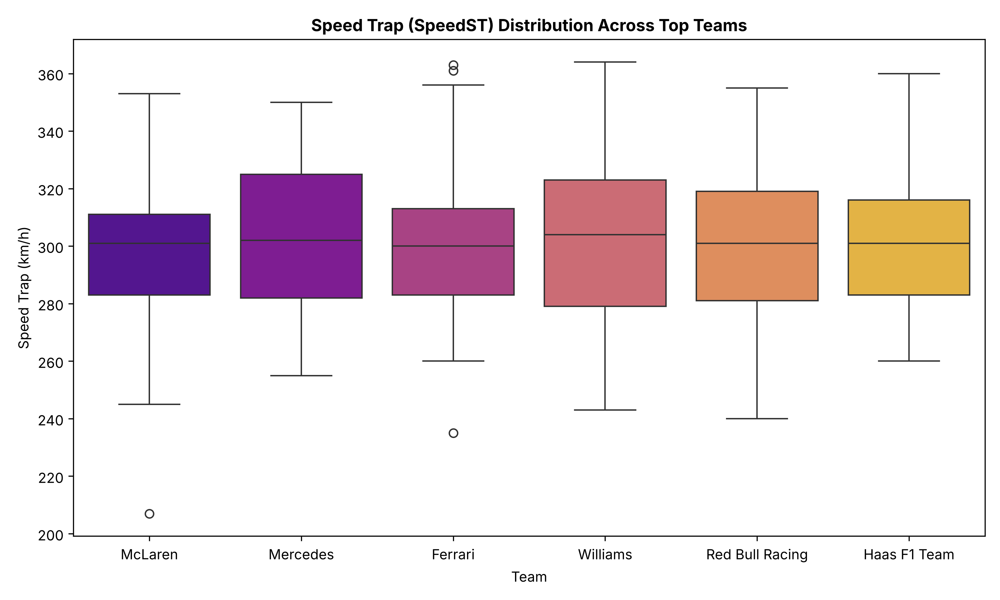
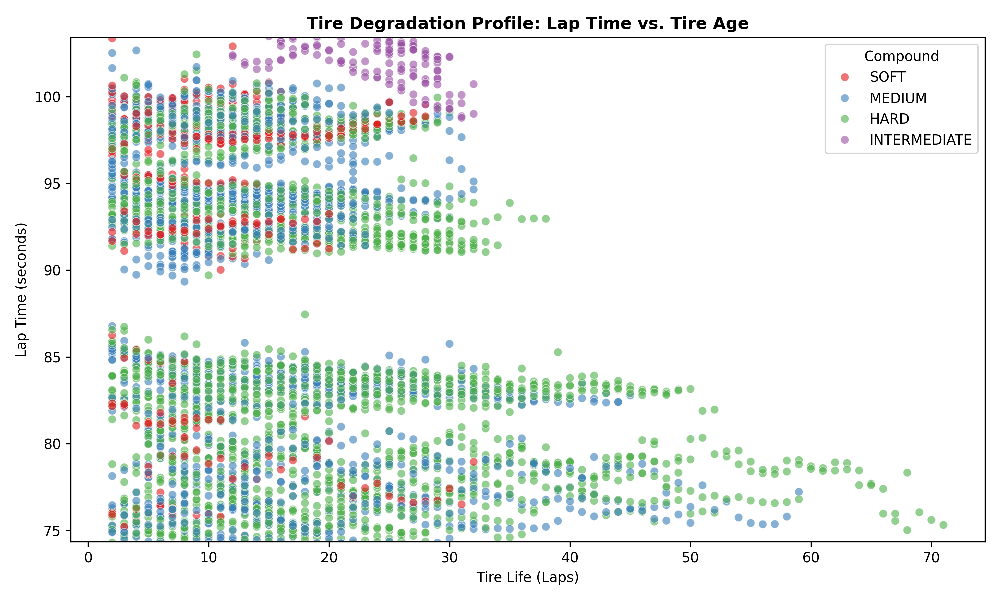

# Technical Project Documentation

## 1. Executive Summary
This project presents an integrated telemetry analysis and machine learning framework utilizing Formula 1 timing and telemetry data. The pipeline analyzes sector times, speed traps, tire degradation profiles, weather dynamics, and stint strategies to derive data-driven insights and construct predictive models for race strategy and outcomes.

---

## 2. Dataset Overview & Data Processing

### 2.1 Dataset Specifications
* **Primary File**: `data/processed/cleaned_laps.csv`
* **Size**: ~2.11 MB
* **Records**: Multi-race lap telemetry covering Grands Prix such as Bahrain, Monaco, Silverstone, Monza, and Suzuka.

### 2.2 Key Features
| Column Name | Data Type | Description |
| :--- | :--- | :--- |
| `Driver` | String | 3-letter driver identifier (e.g., `VER`, `NOR`, `LEC`) |
| `Team` | String | Constructor team name |
| `LapNumber` | Integer | Lap index within the Grand Prix |
| `LapTime_s` | Float | Total lap duration measured in seconds |
| `Compound` | String | Tire compound set (`SOFT`, `MEDIUM`, `HARD`, `INTERMEDIATE`) |
| `TyreLife` | Integer | Total laps completed on the current tire set |
| `SpeedST` | Float | Maximum speed recorded at the circuit Speed Trap (km/h) |
| `IsAccurate` | Boolean | Filter flag indicating green flag laps without track anomalies |

### 2.3 Data Cleaning & Validation Rules
1. **Accurate Lap Filtering**: Outlier lap times caused by Safety Cars (SC), Virtual Safety Cars (VSC), pit stops, and track limit deletions are filtered using `IsAccurate == True`.
2. **Missing Telemetry Imputation**: Missing speed records at specific traps are imputed using team-average compound speeds within the corresponding stint.

---

## 3. Visualization Pipeline Architecture

The visualization module handles the automated export of analytical figures used in project reports and dashboards.

```
                    ┌──────────────────────────────┐
                    │ data/processed/cleaned_laps.csv │
                    └──────────────┬───────────────┘
                                   │
                                   ▼
                    ┌──────────────────────────────┐
                    │ Data Filtering & Preprocessing│
                    │   (IsAccurate == True Filter) │
                    └──────────────┬───────────────┘
                                   │
         ┌─────────────────────────┼─────────────────────────┐
         ▼                         ▼                         ▼
┌─────────────────┐       ┌─────────────────┐       ┌─────────────────┐
│ Speed Trap Box  │       │  Lap Time Line  │       │ Tire Scatter    │
│ Plot Analysis   │       │ Evolution Plot  │       │ Degradation Plot│
└────────┬────────┘       └────────┬────────┘       └────────┬────────┘
         │                         │                         │
         └─────────────────────────┼─────────────────────────┘
                                   │
                                   ▼
                    ┌──────────────────────────────┐
                    │ Save High-Res PNG Figures to │
                    │       reports/figures/       │
                    └──────────────────────────────┘
```

---

## 4. Analytical Insights

### 4.1 Speed Trap Efficiency (`)
* Measures straight-line aerodynamic efficiency and engine power unit performance across top constructor teams.
* Outliers identify low-drag setups tailored for high-speed circuits vs. high-downforce packages.

### 4.2 Stint Pace & Strategy Evolution ()
* Tracks race leader lap times sequentially across the stint.
* Sharp spikes highlight in-laps and out-laps around pit windows, while linear slope decreases reflect fuel-load burnoff balancing tire degradation.

### 4.3 Tire Compound Performance Decay ()
* Evaluates degradation rates across different tire compounds (`SOFT`, `MEDIUM`, `HARD`).
* Demonstrates performance crossover points critical for undercut/overcut pit strategy decisions.

---

## 5. Deployment & Execution Instructions

To execute the technical visualization pipeline independently:

```python
import os
import pandas as pd
import seaborn as sns
import matplotlib.pyplot as plt

# Ensure output directory exists
os.makedirs("reports/figures", exist_ok=True)

# Load telemetry dataset
df = pd.read_csv("data/processed/cleaned_laps.csv")
df_valid = df[df["IsAccurate"] == True]

# Generate and save figures
# (Refer to src/generate_visualizations.py for full plotting methods)
```